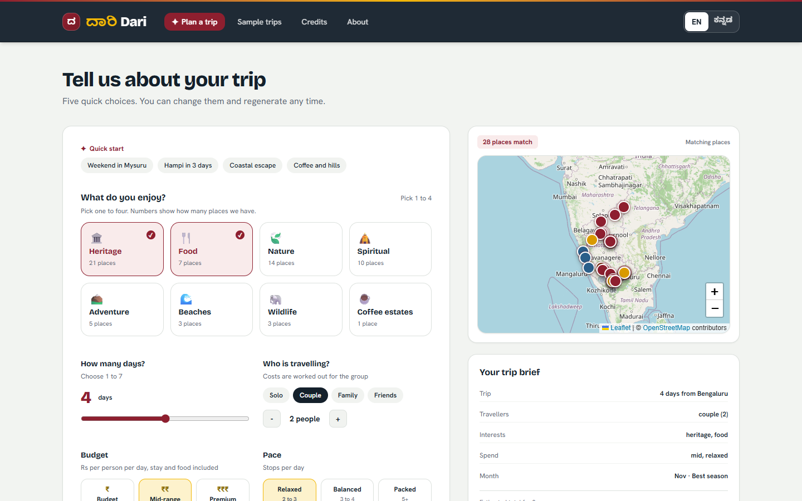
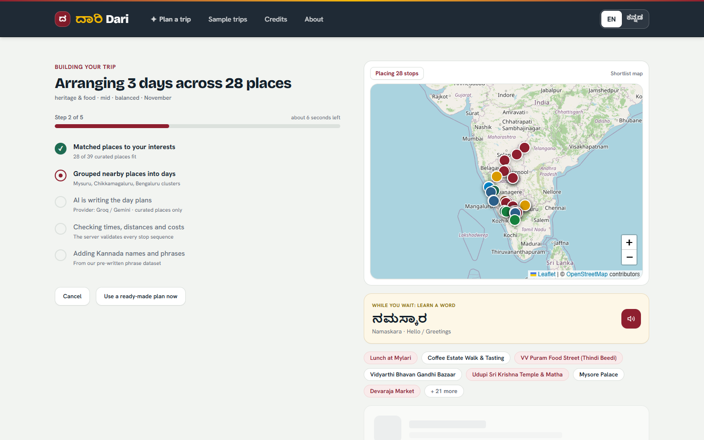
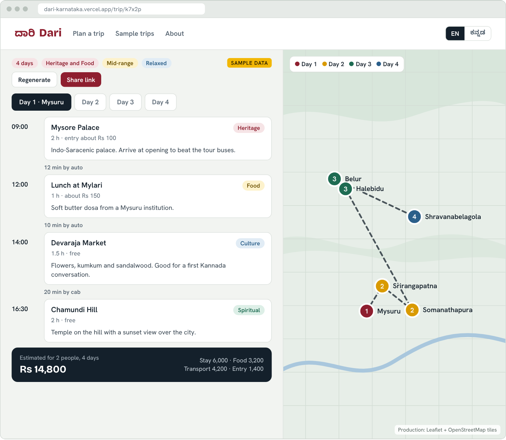
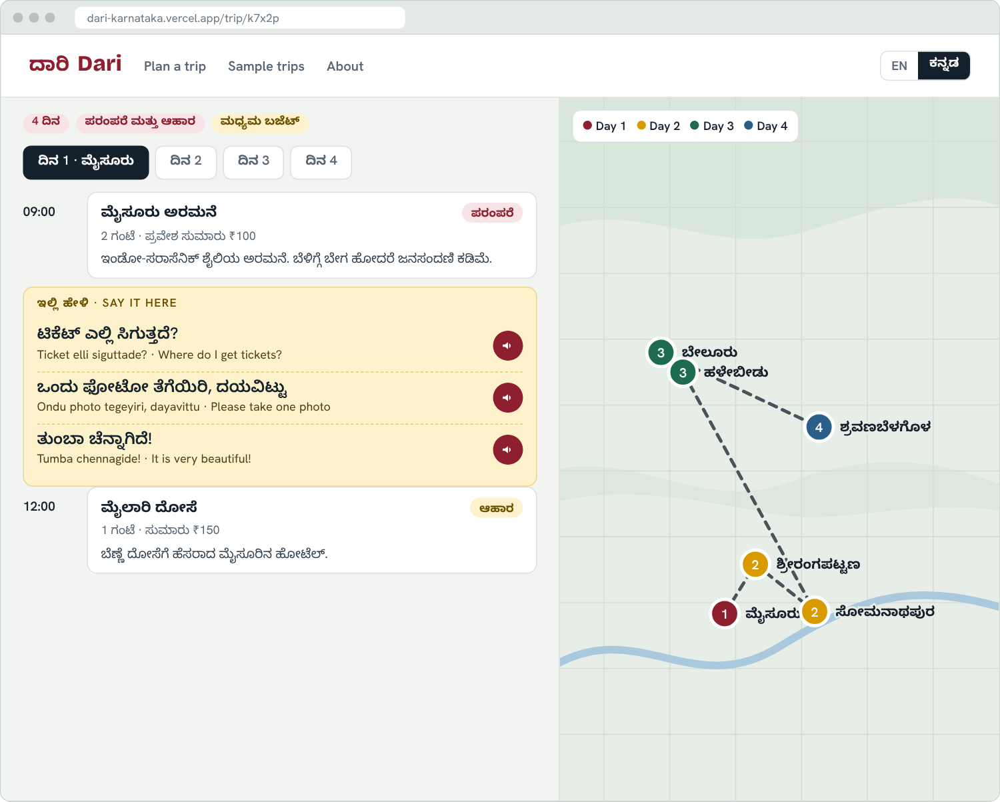
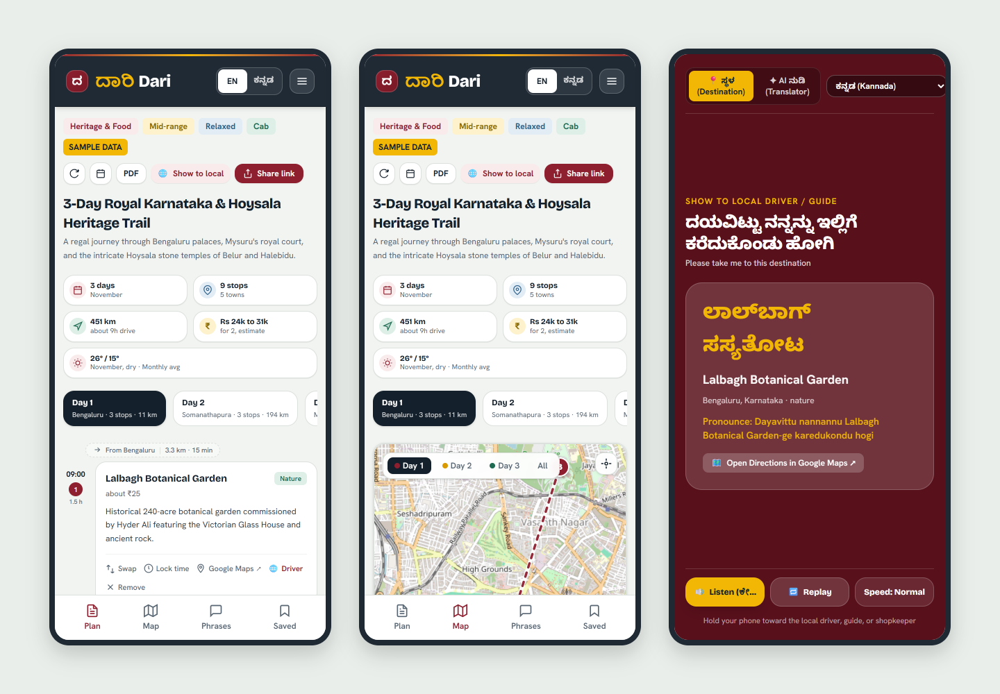
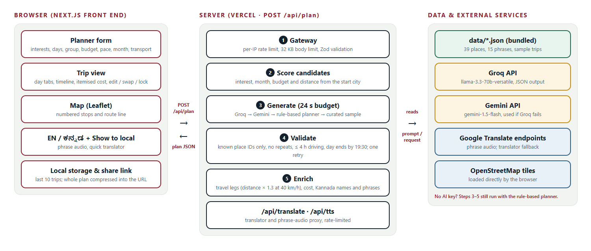

# Dari (ದಾರಿ) — AI Travel Planner for Karnataka

<p align="center">
  <strong>Personalised day-by-day Karnataka itineraries built only from curated places, with a route map, an itemised budget and Kannada phrases for every stop.</strong>
</p>

<p align="center">
  <a href="https://github.com/varshithvardhan2006-09/dari-karnataka-travel-planner/actions/workflows/ci.yml"></a>
  <a href="https://dari-karnataka-travel-planner.vercel.app"></a>
  <a href="LICENSE"></a>
</p>

<p align="center">
  <a href="https://dari-karnataka-travel-planner.vercel.app"><strong>Open the live app ↗</strong></a> •
  <a href="docs/Dari-Presentation.pdf"><strong>Hackathon presentation (PDF)</strong></a>
</p>

---

## Overview

**Dari** (ದಾರಿ, Kannada for *"the way"*) turns a traveller's interests, available days, budget and pace into a day-by-day Karnataka itinerary.

Generic AI chat planners invent monuments, guess ticket prices, pair sights hours apart on the same morning and stop working when the model is rate-limited. Dari avoids this by design:

- The AI may only choose from a **curated list of 39 places**, each with a recorded source. It never writes a place name, fee or coordinate itself.
- Distances, timings and costs are **computed by code**, not generated.
- When no AI provider is available, a **rule-based planner** produces the plan instead, so the app works even with no API keys configured.
- Kannada names and phrases come from a **pre-written dataset**; nothing is machine-translated at runtime.

## Hackathon presentation

Submitted to the **Kannada Digital Innovation Hackathon 2026**, Travel & Tourism track. The deck is at [`docs/Dari-Presentation.pdf`](docs/Dari-Presentation.pdf) and covers the problem, the existing tools, how Dari differs, the approach, the tech stack, the architecture, and the business model and future scope.

## Screenshots

| Landing page | Planner form |
|:---:|:---:|
|  |  |
| *Hero, quick-start bar and region explorer map* | *Interests, days, group size, budget, pace, month and transport* |

| Generating a plan | Itinerary and map |
|:---:|:---:|
|  |  |
| *Progress steps with the real candidate shortlist* | *Day plan, numbered route map and cost breakdown* |

| Kannada mode | Mobile |
|:---:|:---:|
|  |  |
| *Full Kannada interface and the "Show to local" driver card* | *Bottom navigation: Plan, Map, Phrases, Saved* |

## Features

### Places can't be hallucinated
The model receives only a scored shortlist of place IDs from [`data/places.json`](data/places.json) and must answer with those IDs, a start time and a short note. Its output is checked with Zod and business rules: no unknown or repeated places, under 4 hours of driving a day, and every day inside 08:30–19:30. A failed answer gets one retry with the exact errors; after that the next tier takes over.

### Four-tier generation that always answers
Groq (Llama 3.3 70B) → Google Gemini → rule-based nearest-neighbour planner → curated sample. All tiers share a 24-second budget, and every tier's output is enriched the same way.

### Realistic routes and times
Road distance is the straight-line (Haversine) distance × 1.3, driven at 40 km/h with a 10-minute buffer, rounded to 5 minutes. Each day includes the leg from the start city or the previous night's stop, and the trip includes the return leg. Around lunchtime the planner prefers a nearby food stop.

### Honest, itemised budget
Stay + food + transport + entry fees always add up to the total exactly:
- **Stay and food:** per person, by budget tier; no stay cost on a one-day trip
- **Transport:** cab at ₹20/km (auto at ₹16/km for short solo trips), own car at ₹13/km, or bus and train at ₹4/km per person
- **Entry fees:** each place's listed fee × the group size

### Kannada for real conversations
- Every place and phrase has a pre-written Kannada version
- Phrase audio in Kannada, Hindi, Telugu, Tamil, Malayalam and English. A server-side proxy fetches it from Google Translate's speech endpoint, and the browser's Web Speech API is the fallback.
- **Show to local:** a full-screen card reading *"ದಯವಿಟ್ಟು ನನ್ನನ್ನು ಇಲ್ಲಿಗೆ ಕರೆದುಕೊಂಡು ಹೋಗಿ"* (*Please take me here*) with the destination, plus a quick translator for other phrases
- Google Maps search and directions links for every stop

### Edit, share and save, with no account
- Swap, remove or add stops, change each leg's travel mode, and lock a stop's start time
- Share a whole trip as one link (the plan is compressed into the URL; nothing is stored on a server)
- Export the trip to your calendar as an `.ics` file, or print it as a PDF
- The last 10 trips are saved in your browser

## Architecture

<p align="center">
  
</p>

1. **Input** — the planner form sends the trip brief to `POST /api/plan`.
2. **Gateway** — per-IP rate limit, 32 KB body limit and Zod validation.
3. **Candidate scoring** ([`src/lib/candidates.ts`](src/lib/candidates.ts)) — ranks places by interest match, month, budget and distance from the start city.
4. **Generation** ([`src/lib/ai.ts`](src/lib/ai.ts)) — the four-tier cascade above; the offline planner is in [`src/lib/planner.ts`](src/lib/planner.ts).
5. **Enrichment** ([`src/lib/enrich.ts`](src/lib/enrich.ts)) — travel legs, timings, itemised cost, Kannada names and phrases.
6. **Trip view** ([`src/app/trip/page.tsx`](src/app/trip/page.tsx)) — Leaflet map, day plan, costs, phrases, sharing and export.

## Dataset

39 places across Karnataka in [`data/places.json`](data/places.json), plus 15 Kannada travel phrases in [`data/phrases.json`](data/phrases.json):

| Area | Places |
|---|---|
| **Bengaluru** | Lalbagh Botanical Garden, Bangalore Palace, VV Puram Food Street, Vidyarthi Bhavan |
| **Mysuru and around** | Mysore Palace, Chamundi Hill, Devaraja Market, Mysore Zoo, Brindavan Gardens, Mylari, Sri Ranganathaswamy Temple, Tipu Sultan's Summer Palace, Somanathapura Chennakeshava Temple, Bandipur National Park |
| **Hoysala heartland** | Belur Chennakeshava Temple, Halebidu Hoysaleswara Temple, Shravanabelagola |
| **Hampi, Badami and the north** | Virupaksha Temple, Vittala Temple & Stone Chariot, Hemakuta Hill, Lotus Mahal & Elephant Stables, Badami Cave Temples, Pattadakal, Aihole, Gol Gumbaz, Bidar Fort, Kalaburagi Fort, Dharwad Peda (Line Bazaar) |
| **Coast** | Gokarna Mahabaleshwar Temple, Om Beach, Udupi Sri Krishna Matha, Malpe Beach & St. Mary's Island, Murudeshwar, Jog Falls |
| **Coorg and Chikkamagaluru** | Abbey Falls, Raja's Seat, Dubare Elephant Camp, Mullayanagiri, Coffee estate walk |

## Data sources

### Places

Every place in [`data/places.json`](data/places.json) records the source its details come from (`source_url`). That covers its description, Kannada name, visit duration, entry fee, best months and tips. Sources are recorded at website level, not individual pages.

| Source | Places |
|---|---|
| [Karnataka Tourism](https://karnatakatourism.org) — Department of Tourism, Government of Karnataka | 21 |
| [Archaeological Survey of India](https://asi.nic.in) | 8 |
| [Hampi official portal](https://hampi.nic.in) | 2 |
| [Kodagu (Coorg) district portal](https://coorg.nic.in) | 2 |
| [Chikkamagaluru district portal](https://chikkamagaluru.nic.in) | 2 |
| [Mysore Palace Board](https://mysorepalace.karnataka.gov.in) | 1 |
| [Mysuru Zoo](https://mysorezoo.info) — Sri Chamarajendra Zoological Gardens | 1 |
| [Karnataka Forest Department](https://aranya.gov.in) | 1 |
| [Vidyarthi Bhavan](https://vidyarthibhavan.in) — the restaurant's own site | 1 |

Each entry also has a `verified` flag. **17 of the 39 places** are marked as checked against their source; the other 22 record a source but are still awaiting that check. Entry fees and opening hours change, so confirm them before visiting.

<details>
<summary><strong>Source for each of the 39 places</strong></summary>

| Area | Place | Source | Checked |
|---|---|---|:---:|
| Bengaluru | Lalbagh Botanical Garden | Karnataka Tourism | |
| Bengaluru | Bangalore Palace | Karnataka Tourism | |
| Bengaluru | VV Puram Food Street (Thindi Beedi) | Karnataka Tourism | ✓ |
| Bengaluru | Vidyarthi Bhavan, Gandhi Bazaar | Vidyarthi Bhavan | ✓ |
| Mysuru | Mysore Palace | Mysore Palace Board | |
| Mysuru | Chamundi Hill | Karnataka Tourism | ✓ |
| Mysuru | Devaraja Market | Karnataka Tourism | ✓ |
| Mysuru | Mysore Zoo | Mysuru Zoo | |
| Mysuru | Brindavan Gardens | Karnataka Tourism | |
| Mysuru | Mylari (lunch stop) | Karnataka Tourism | ✓ |
| Mysuru | Sri Ranganathaswamy Temple, Srirangapatna | Karnataka Tourism | ✓ |
| Mysuru | Tipu Sultan's Summer Palace (Dariya Daulat) | Archaeological Survey of India | |
| Mysuru | Chennakeshava Temple, Somanathapura | Archaeological Survey of India | |
| Mysuru | Bandipur National Park safari | Karnataka Forest Department | |
| Hassan | Belur Chennakeshava Temple | Karnataka Tourism | ✓ |
| Hassan | Halebidu Hoysaleswara Temple | Karnataka Tourism | ✓ |
| Hassan | Shravanabelagola Gommateshwara | Karnataka Tourism | ✓ |
| Hampi | Virupaksha Temple | Hampi official portal | |
| Hampi | Vittala Temple & Stone Chariot | Archaeological Survey of India | |
| Hampi | Hemakuta Hill sunset | Hampi official portal | ✓ |
| Hampi | Lotus Mahal & Elephant Stables | Archaeological Survey of India | |
| Badami | Badami Cave Temples | Archaeological Survey of India | |
| Badami | Pattadakal Monument Group | Archaeological Survey of India | |
| Badami | Aihole Durga Temple Complex | Archaeological Survey of India | |
| North Karnataka | Gol Gumbaz, Vijayapura | Archaeological Survey of India | |
| North Karnataka | Bidar Fort | Karnataka Tourism | ✓ |
| North Karnataka | Kalaburagi Fort & Jami Masjid | Karnataka Tourism | ✓ |
| North Karnataka | Dharwad Peda tasting (Line Bazaar) | Karnataka Tourism | ✓ |
| Coast | Gokarna Mahabaleshwar Temple | Karnataka Tourism | ✓ |
| Coast | Om Beach, Gokarna | Karnataka Tourism | ✓ |
| Coast | Udupi Sri Krishna Temple & Matha | Karnataka Tourism | ✓ |
| Coast | Malpe Beach & St. Mary's Island | Karnataka Tourism | |
| Coast | Murudeshwar Shiva Statue & Beach | Karnataka Tourism | |
| Coast | Jog Falls | Karnataka Tourism | |
| Coorg | Abbey Falls, Madikeri | Kodagu district portal | |
| Coorg | Raja's Seat, Madikeri | Kodagu district portal | |
| Coorg | Dubare Elephant Camp | Karnataka Tourism | |
| Chikkamagaluru | Mullayanagiri Peak | Chikkamagaluru district portal | ✓ |
| Chikkamagaluru | Coffee estate walk & tasting | Chikkamagaluru district portal | |

</details>

### Everything else

| Data | Where it comes from |
|---|---|
| Kannada phrases (15) | Pre-written in [`data/phrases.json`](data/phrases.json); no external source is recorded |
| Map tiles | [OpenStreetMap](https://www.openstreetmap.org/copyright) contributors, credited on every map |
| Directions | Links out to [Google Maps](https://maps.google.com) using each place's coordinates |
| Phrase audio | Google Translate's speech endpoint through a server-side proxy; the browser's Web Speech API is the fallback |
| Free-text translation | Groq or Google Gemini, then Google Translate's public endpoint, then a built-in offline phrase list |
| Itinerary order and notes | Groq or Google Gemini; the rule-based planner when no AI provider is available |
| Distances and travel times | Calculated in [`src/lib/geo.ts`](src/lib/geo.ts) (straight-line distance × 1.3, at 40 km/h); no routing service is used |
| Stay, food and transport rates | Planning estimates set in [`src/lib/cost.ts`](src/lib/cost.ts), not taken from a published source |
| Monthly weather on the trip page | Typical averages written in [`src/app/trip/page.tsx`](src/app/trip/page.tsx); no source is recorded |
| Starting-city locations | Approximate coordinates in [`src/lib/candidates.ts`](src/lib/candidates.ts) |
| Illustrations | Original inline SVG drawings in [`src/components/illustrations`](src/components/illustrations) |

### How costs are estimated

Entry fees come from each place's `entry_inr` in `data/places.json`. Every other rate in [`src/lib/cost.ts`](src/lib/cost.ts) is a planning figure meant to match typical prices in Karnataka. None is copied from a published tariff.

| Item | Rate used | What it is meant to cover |
|---|---|---|
| Stay, per person per night | Budget ₹1,000 · Mid ₹2,200 · Premium ₹4,200 | Hostel or basic room · 3-star hotel or homestay · heritage or resort stay |
| Food, per person per day | Budget ₹600 · Mid ₹1,200 · Premium ₹2,000 | Darshini and Udupi meals · sit-down restaurants · resort and fine dining |
| Cab | ₹20/km + ₹150/day | Hired car with a daily driver allowance |
| Auto | ₹16/km + ₹150/day | Used instead of a cab for one traveller going under 40 km |
| Own car | ₹13/km + ₹100/day | Fuel, wear, tolls and parking |
| Bus or train | ₹4/km per person + ₹100/day | KSRTC or rail fare plus local autos |
| Entry tickets | Sum of `entry_inr` × travellers | The listed fee at each stop |

A trip of *N* days is charged for *N* − 1 nights, so a day trip has no stay cost. The total is always exactly stay + food + transport + entry.

## Tech stack

| Layer | Technology |
|---|---|
| Framework | Next.js 16 (App Router, Turbopack), React 19 |
| Language | TypeScript 5 (strict) |
| Styling | Tailwind CSS v4 |
| Validation | Zod 4 — API requests, AI output and shared links |
| Maps | Leaflet with OpenStreetMap tiles |
| AI | Groq (`llama-3.3-70b-versatile`), Google Gemini (`gemini-1.5-flash`) |
| Speech | Server-side Google Translate speech proxy, Web Speech API fallback |
| Sharing | LZ-String URL compression, iCalendar (`.ics`) export |
| Testing | Vitest — 18 suites, 128 tests, fully offline |
| CI/CD | GitHub Actions (lint, test, build) and Vercel |

## Run locally

Requires **Node.js 20.9 or newer**.

```bash
git clone https://github.com/varshithvardhan2006-09/dari-karnataka-travel-planner.git
cd dari-karnataka-travel-planner
npm install
npm run dev
```

Then open http://localhost:3000.

**API keys are optional.** Without them, Dari uses its rule-based planner. To enable AI planning, copy `.env.example` to `.env.local` and add a `GROQ_API_KEY` and/or `GEMINI_API_KEY`.

| Command | What it does |
|---|---|
| `npm test` | Runs the test suite (offline; every external service is stubbed) |
| `npm run lint` | Runs ESLint |
| `npm run build` | Builds for production |
| `npm run generate:samples` | Regenerates the sample trips in `data/samples/`; the tests fail if they drift from the planner |

## API

| Endpoint | Purpose | Limits |
|---|---|---|
| `POST /api/plan` | Generate an itinerary | 12 requests/min per IP, 32 KB body |
| `GET /api/plan` | Health check (returns the place count) | — |
| `POST /api/translate` | Translate a travel phrase (`kn`, `hi`, `te`, `ta`, `ml`, `en`) | 20 requests/min per IP, 500 characters |
| `GET /api/tts?text=…&lang=kn` | Stream phrase audio (`audio/mpeg`) | 60 requests/min per IP |

Example `POST /api/plan` body:

```json
{
  "interests": ["heritage", "nature"],
  "days": 3,
  "start_city": "Bengaluru",
  "budget": "mid",
  "pace": "balanced",
  "travellers": "couple",
  "month": 11,
  "lang": "en",
  "people_count": 2,
  "food_preference": "veg",
  "transport_mode": "cab"
}
```

Over-limit requests get `429` with a `Retry-After` header; invalid input gets `400`.

## Security

- API keys live only in `.env.local`, which is git-ignored and has never been committed.
- Every API route is rate-limited per IP and has a request size limit, so the speech proxy and translator can't be abused as open relays.
- Shared trip links are validated against the plan schema before anything is shown, and map pop-up text is HTML-escaped.
- Nothing personal is stored on a server; saved trips stay in your browser.

## Roadmap

- Live KSRTC bus and rail timings for inter-city legs
- Offline progressive web app with cached map tiles
- Monsoon and temple-crowd signals feeding the route
- Hands-free voice changes for travellers on the road
- Shared rate limiting across server instances (Redis / Vercel KV)

## Author

**Chiluveru Varshith Vardhan** — Maturi Venkata Subba Rao (MVSR) Engineering College · [GitHub](https://github.com/varshithvardhan2006-09)

Licensed under the [MIT License](LICENSE).
