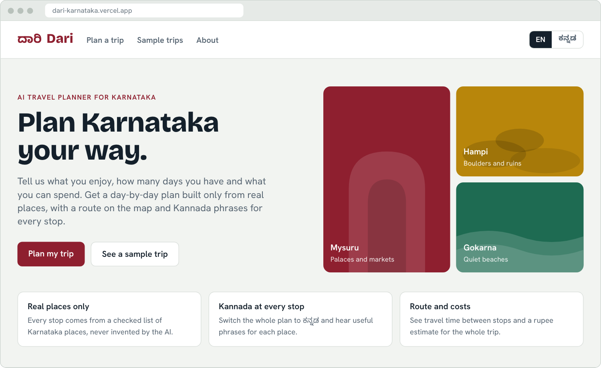
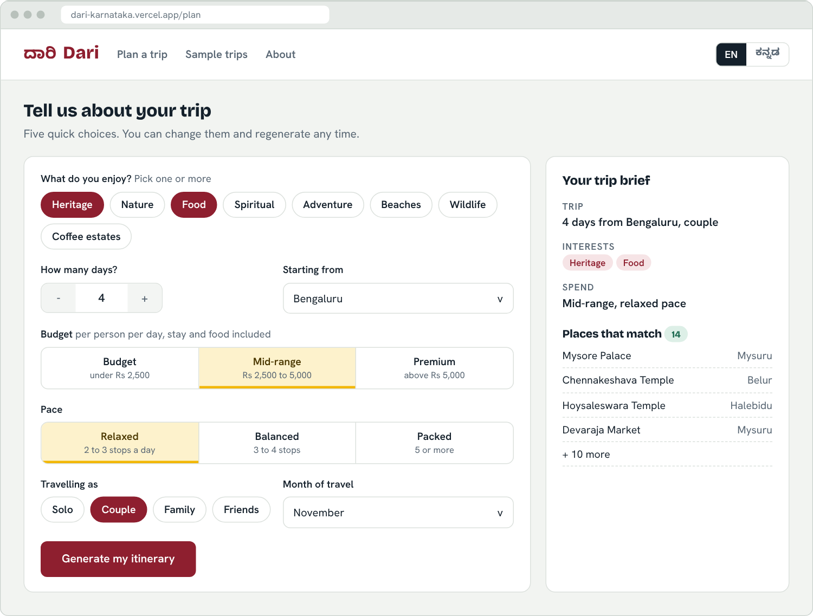
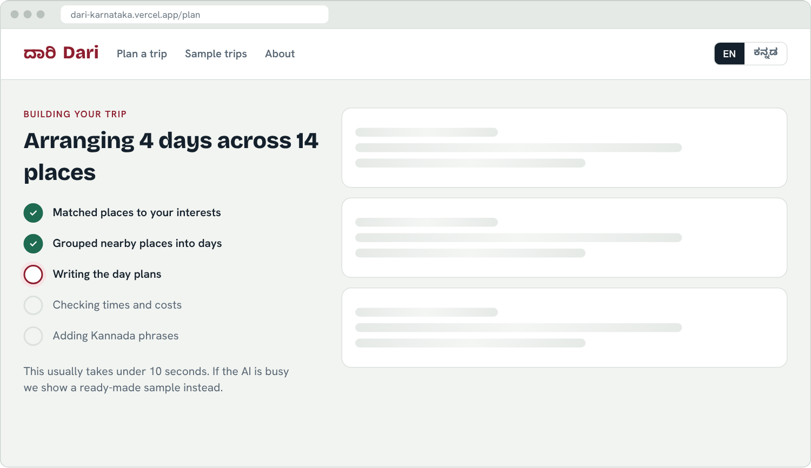
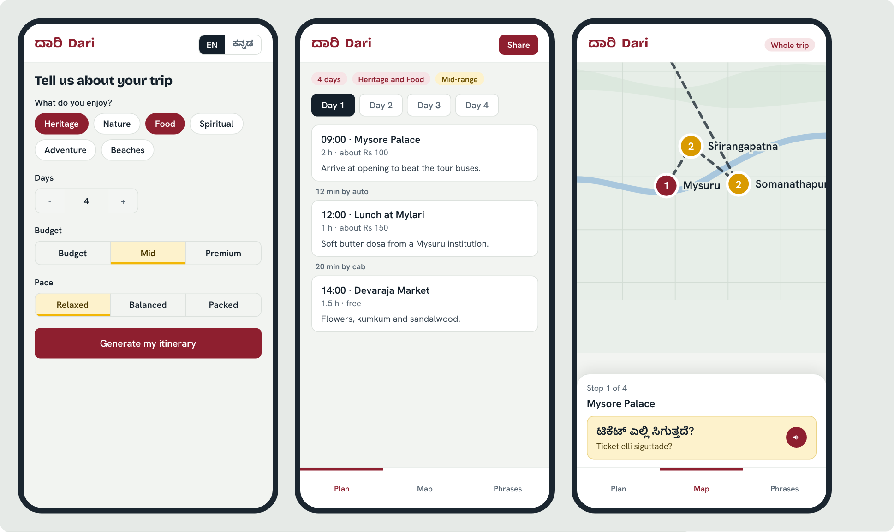
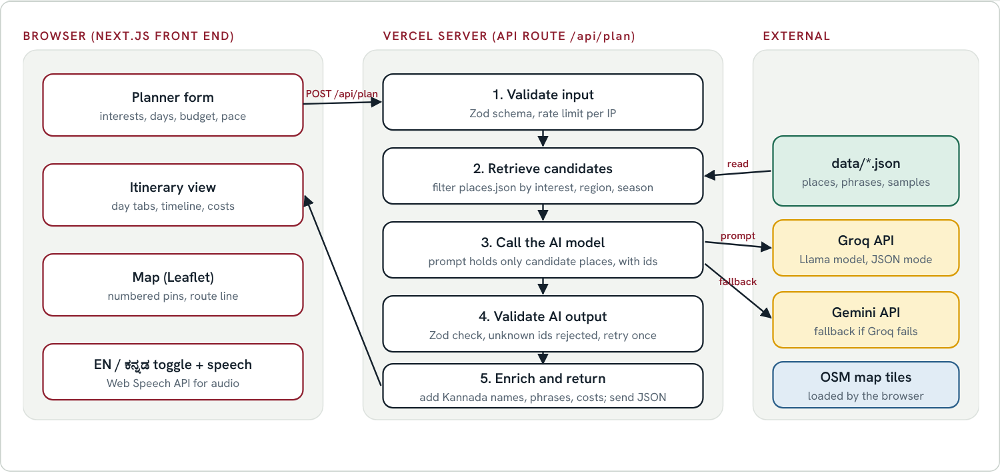

# Dari (ದಾರಿ) - AI Travel Planner for Karnataka

[](https://nextjs.org/)
[](https://www.typescriptlang.org/)
[](https://tailwindcss.com/)
[](https://github.com/varshithvardhan2006-09/dari-karnataka-travel-planner/actions)
[](https://vitest.dev/)
[](LICENSE)

> **Problem Statement 06:** AI-powered travel planner that creates personalized Karnataka itineraries based on interests, available time, budget, and preferred type of experience.
>
> Built for the **Kannada Digital Innovation Hackathon 2026** (*"Code. Create. Celebrate Kannada."*).
>
> 🌐 **Live URL:** [https://dari-karnataka-travel-planner.vercel.app](https://dari-karnataka-travel-planner.vercel.app)  
> 📁 **GitHub Repository:** [https://github.com/varshithvardhan2006-09/dari-karnataka-travel-planner](https://github.com/varshithvardhan2006-09/dari-karnataka-travel-planner)

---

## 📸 Interface & Mockup Architecture

| 1. Landing & Destination Discovery | 2. Planner Form & Live Brief |
|:---:|:---:|
|  |  |
| *Bento SVG scene art, quick-start bar, trust cards, region explorer* | *8 live interest tiles, presets, days slider, sticky brief panel* |

| 3. Generating Screen | 4. Itinerary & Interactive Map |
|:---:|:---:|
|  |  |
| *5-stage real progress, candidate route preview, "learn a word"* | *5 stat cards, day tabs, double-polyline map, donut cost chart* |

| 5. Kannada Mode & Stop Details | 6. Mobile Experience (360px) |
|:---:|:---:|
|  |  |
| *Full Kannada UI, stop drawer, "Show to Local" driver screen* | *4 bottom tabs (Plan, Map, Phrases, Saved), compact cards* |

---

## 🌟 What Makes Dari Different

Generic AI planners (like raw ChatGPT or Gemini prompts) hallucinate non-existent monuments, combine sights in different cities on the same morning, estimate absurd driving times, output broken machine-translated Kannada, and fail completely when rate-limited.

**Dari solves this with 6 core architectural principles:**

1. **Constrained Place-ID Architecture (Place-ID Constrained, Hallucination Prevention):**  
   The AI model is **strictly prohibited from generating free-text place names, coordinates, or fees**. The prompt receives only valid candidate IDs from [`data/places.json`](data/places.json) and must return valid IDs. Any unknown ID is automatically rejected, retried once, and backed by our deterministic fallback planner.
2. **Honesty & Transparency Rule:**  
   We reject deceptive claims like `~99% verified` or `benchmarked against KSTDC`. Dari labels all numbers honestly:
   > *"Estimates from our dataset. Prices change, so check before you book."*  
   > Unverified facts are marked `verified: false` and cataloged in [`docs/TODO-VERIFY.md`](docs/TODO-VERIFY.md).
3. **First-Class Kannada (ಕನ್ನಡ) without Runtime LLM Translation:**  
   A single toggle instantly switches the entire interface, place names, descriptions, tips, and phrases to verified Kannada. Every Kannada string is pre-curated in [`data/places.json`](data/places.json), [`data/phrases.json`](data/phrases.json), or [`src/lib/i18n/kn.json`](src/lib/i18n/kn.json) — zero garbled translation.
4. **Contextual Phrases & Native Kannada Audio Stream:**  
   Every stop includes 2 to 3 practical Kannada phrases with script, English transliteration, English meaning, and high-fidelity native Kannada speech streaming (`/api/tts`) with browser Web Speech fallback.
5. **"Show to Local" Full-Screen View:**  
   A dedicated high-contrast red card displaying *"ದಯವಿಟ್ಟು ನನ್ನನ್ನು ಇಲ್ಲಿಗೆ ಕರೆದುಕೊಂಡು ಹೋಗಿ"* (*Please take me here*) with destination details and native audio designed for auto drivers, bus conductors, and shopkeepers.
6. **Works without AI keys (Deterministic Fallback):**  
   Even if both Groq and Gemini APIs are down, rate-limited, or if zero API keys are provided, Dari generates a complete, geographically clustered itinerary using [`src/lib/planner.ts`](src/lib/planner.ts) with zero user-facing errors.

---

## 🏛️ System Architecture & Data Flow



### The Request Pipeline (`POST /api/plan`)

```
[ User Input: Interests, Days (1-7), Start City, Budget, Pace, Travellers, Month ]
                               │
                               ▼
[ 1. Zod Request Validation & In-Memory Rate Limiting (12 req/min/IP) ]
                               │
                               ▼
[ 2. Candidate Filtering & Scoring (lib/candidates.ts) ]
   ├── Distance from start city (Haversine km)
   ├── Best travel month bonus
   ├── Budget tier compatibility
   └── Keeps ~2.5x stops needed for requested pace
                               │
                               ▼
[ 3. Cascading AI Execution (lib/ai.ts) ]
   ├── Primary: Groq API (openai/gpt-oss-120b, JSON Mode)
   ├── Secondary Fallback: Google Gemini API (gemini-flash-latest)
   └── Validates place IDs with Zod (1 retry with feedback)
                               │
                               ▼ (on AI failure, timeout, or missing keys)
[ 4. Deterministic Planner Fallback (lib/planner.ts) ]
   ├── Greedy nearest-neighbour geographic clustering
   ├── Pace stop limit enforcement & meal stop insertion
   └── Zero duplicate places guaranteed across multi-day trips
                               │
                               ▼
[ 5. Plan Enrichment Engine (lib/enrich.ts) ]
   ├── Road distance (Haversine × 1.3 factor)
   ├── Realistic drive times (40 km/h + 10 min buffer, rounded to 5 min)
   ├── Transport mode selection (Auto, Cab, Walk)
   ├── Itemized rupee cost calculation (Stay + Food + Transport + Entry === Total)
   └── Attaches localized Kannada text and audio phrases
                               │
                               ▼
[ Final JSON Plan returned to Client with source badge: "ai-groq" | "ai-gemini" | "planner" | "sample" ]
```

---

## 🗺️ Beyond the Golden Triangle: 39 Curated Places

Our dataset covers 39 hand-curated places spanning all regions of Karnataka:

- **Kalyana-Karnataka:** Bidar Fort, Mahmud Gawan Madrasa, Kalaburagi Fort & Jami Masjid.
- **Badami-Bagalkot:** Badami Cave Temples, Pattadakal Monument Complex, Aihole Durga Temple, Gol Gumbaz (Vijayapura).
- **Karavali Coast:** Mangaluru Beaches & Food, Udupi Sri Krishna Matha, Malpe Beach & St. Mary's Island, Murudeshwar Temple & Shiva Statue, Gokarna Om Beach & Mahabaleshwar.
- **Malenadu & Western Ghats:** Chikkamagaluru Coffee Estates, Mullayanagiri Peak, Baba Budangiri, Jog Falls, Abbey Falls, Raja's Seat, Dubare Elephant Camp, Dandeli River Rafting.
- **Southern Heritage & Mysuru:** Mysore Palace, Chamundi Hill & Monolithic Nandi, Mysore Zoo, Devaraja Market, Ranganathaswamy Temple (Srirangapatna), Brindavan Gardens, Somanathapura Keshava Temple.
- **Hoysala Trail:** Belur Chennakeshava Temple, Halebidu Hoysaleswara Temple, Shravanabelagola Gommateshwara.
- **Hampi & Ballari:** Virupaksha Temple, Vittala Temple & Stone Chariot, Lotus Mahal & Elephant Stables, Matanga Hill Sunrise.
- **Bengaluru Hub:** Lalbagh Botanical Garden & Glass House, Bangalore Palace, Tipu Sultan's Summer Palace, Vidyarthi Bhavan, VV Puram Food Street.

---

## 🛠️ Tech Stack & Key Libraries

| Layer | Technology | Details |
|---|---|---|
| **Framework** | Next.js 16.4.2 (App Router) + React 19 | Server & client routing with Turbopack |
| **Language** | TypeScript 5.0 (Strict mode) | Compile-time safety and self-documenting code |
| **Styling** | Tailwind CSS v4 | Karnataka flag tokens (`#8E1F2F` crimson, `#F2B705` gold, `#1E6B52` green) |
| **Typography** | Bricolage Grotesque, Hanken Grotesk, Noto Sans Kannada | Correct native Kannada rendering with `line-height: 1.55` |
| **Map Engine** | Leaflet 1.9 + OpenStreetMap | Native Leaflet container (no SSR memory leaks), custom numbered pin markers, double polyline route |
| **Primary AI** | Groq API (`llama-3.3-70b-versatile` / `openai/gpt-oss-120b`) | Rapid inference (< 1.5s) in structured JSON mode |
| **Fallback AI** | Google Gemini API (`gemini-flash-latest`) | Secondary fallback provider |
| **Validation** | Zod 4 (`.issues` syntax) | Runtime input validation and AI output schema checks |
| **URL Compression**| LZ-String 1.5 | Compresses entire JSON itinerary into URL `?d=...` for database-free sharing |
| **Local Storage** | Web Storage API | Auto-saves last 10 trips on device ("My Trips") without login |
| **Calendar Export**| iCalendar (`.ics`) RFC 5545 | Generates downloadable calendar schedule client-side |
| **Speech** | Native Kannada Audio Stream (`/api/tts`) + Web Speech | Streamed native audio with Web Speech fallback and slow-rate controls |
| **Testing** | Vitest 5.0 (12 test suites, 57 tests) | Automated unit, schema, geo & integration testing |
| **CI/CD** | GitHub Actions + Vercel | Automated CI matrix (lint, Vitest, Next.js build) & continuous deployment |

---

## 🚀 Getting Started

### 1. Prerequisites
- Node.js 18.18+ or Node 20+ (tested on Node 20 and Node 24)
- npm 9+

### 2. Installation
```bash
git clone https://github.com/varshithvardhan2006-09/dari-karnataka-travel-planner.git
cd dari-karnataka-travel-planner
npm install --legacy-peer-deps
```

### 3. Environment Variables
Copy `.env.example` to `.env.local`:
```bash
cp .env.example .env.local
```

Fill in your API keys (optional — Dari runs automatically in deterministic planner mode if keys are omitted):
```env
# Primary AI Provider (Groq)
GROQ_API_KEY=your_groq_api_key_here
GROQ_MODEL=openai/gpt-oss-120b

# Fallback AI Provider (Google Gemini)
GEMINI_API_KEY=your_gemini_api_key_here
GEMINI_MODEL=gemini-2.5-flash

# Base URL for Open Graph & Social Sharing
NEXT_PUBLIC_APP_URL=https://dari-karnataka-travel-planner.vercel.app
```

### 4. Running the Development Server
```bash
npm run dev
```
Open [http://localhost:3000](http://localhost:3000) in your browser.

### 5. Running the Test Suite
```bash
npm run test
```
Executes 45 tests across 12 test suites:
- Candidate scoring and multi-factor filtering tests
- Cost calculation math invariants (`stay + food + transport + entry === total`)
- Cost range estimation helper tests
- Deterministic fallback planner tests
- AI cascade error rejection & retry tests
- Zod schema validator tests
- Share link compression/decompression tests
- Kannada language and audio phrase tests
- Sample itinerary schema conformity tests
- Error recovery & 429 rate limit tests
- Stop start time 5-minute rounding and non-overlap tests
- Wikimedia Commons photo licensing and credit compliance tests

### 6. Building for Production
```bash
npm run build
npm run start
```

---

## 📱 Mobile-First Features (Tested at 360px & 390px)

- **Bottom Navigation Bar:** Mobile users get fixed bottom tabs:
  - **Plan:** Day tabs, stop cards, add-a-stop suggestions, and donut cost chart.
  - **Map:** Fullscreen interactive map with animated numbered pins, double-polyline route, and a compact, minimizable bottom sheet.
  - **Phrases:** Full Kannada phrasebook for the day's stops with audio playback.
  - **Saved:** "My Trips" saved on this device (up to 10 plans) without login.
- **Show to Local Mode:** One-tap crimson full-screen card for auto drivers and conductors.
- **Touch Targets:** All interactive elements designed with minimum 44px hit areas and safe-area inset padding.

---

## 📁 Repository Structure

```
dari-karnataka/
├── public/
│   ├── favicon.ico            # 32x32 Karnataka-branded icon
│   └── og-image.png           # 1200x630 social share preview
├── data/
│   ├── places.json            # 39 hand-curated Karnataka places
│   ├── phrases.json           # 15 contextual Kannada phrases
│   └── samples/               # 4 pre-computed verified itineraries
│       ├── heritage.json      # Royal Mysuru & Hoysala Trail (4 days)
│       ├── nature.json        # Western Ghats & Wildlife (4 days)
│       ├── food.json          # Karavali Coast & Culinary (4 days)
│       └── mixed.json         # Karnataka Grand Panorama (5 days)
├── scripts/
│   └── fetch-images.mjs       # Wikimedia Commons API image fetch script
├── src/
│   ├── app/
│   │   ├── layout.tsx         # Fonts, metadataBase, LangProvider
│   │   ├── globals.css        # Tailwind theme, Kannada line-height, print CSS
│   │   ├── page.tsx           # Redesigned landing page (U1)
│   │   ├── credits/page.tsx   # Wikimedia Commons photo attribution page (U10)
│   │   ├── not-found.tsx      # Branded 404 page (U7)
│   │   ├── error.tsx          # Branded error boundary (U7)
│   │   ├── plan/page.tsx      # Planner form & trip brief (U2)
│   │   ├── trip/page.tsx      # Results screen, tabs, Leaflet map, mobile view (U4)
│   │   └── api/plan/route.ts  # Next.js API route with rate limiting
│   ├── components/
│   │   ├── illustrations/     # Pure inline SVG scene components (U1)
│   │   │   ├── PalaceScene.tsx
│   │   │   ├── HampiScene.tsx
│   │   │   └── CoastScene.tsx
│   │   ├── KarnatakaMapSvg.tsx# Pure SVG interactive Karnataka state map
│   │   ├── PlaceImage.tsx     # Wikimedia photo loader with SVG scene fallback
│   │   ├── StopDetailDrawer.tsx # Slide-out stop facts grid & swap drawer (U5)
│   │   ├── ShowToLocalModal.tsx # Full-screen red driver communication modal (U6)
│   │   ├── PlannerForm.tsx    # Form with interest tiles & live brief (U2)
│   │   ├── ProgressSteps.tsx  # 5-step animated generation progress (U3)
│   │   ├── DayTabs.tsx        # Day switcher with city badges
│   │   ├── StopCard.tsx       # Stop card with swap, lock time, remove (U4)
│   │   ├── PhraseCard.tsx     # Kannada audio phrase with kn-IN speech
│   │   ├── TripMap.tsx        # Leaflet map, numbered day pins, double polyline
│   │   ├── CostSummary.tsx    # Donut chart with honest estimate disclaimer (U4)
│   │   ├── LangToggle.tsx     # EN / ಕನ್ನಡ toggle with persistence
│   │   ├── ErrorState.tsx     # 429 busy, few matches, fallback cards (U7)
│   │   └── Navbar.tsx         # Responsive header with credits link
│   └── lib/
│       ├── schema.ts          # Complete Zod schemas & TypeScript types
│       ├── candidates.ts      # Multi-factor candidate scoring & match counter
│       ├── geo.ts             # Haversine distance, 5-min rounding, pin numbering
│       ├── cost.ts            # Rupee budget estimation & range calculation
│       ├── planner.ts         # Greedy nearest-neighbour fallback planner
│       ├── ai.ts              # Groq -> Gemini -> Fallback cascade client
│       ├── enrich.ts          # Plan enrichment engine & non-overlapping times
│       ├── samples.ts         # Pre-computed sample loader
│       ├── speech.ts          # Web Speech API wrapper for kn-IN voice
│       └── i18n/
│           ├── en.json        # Complete English dictionary
│           ├── kn.json        # Complete Kannada dictionary
│           └── useLang.tsx    # Language provider and hook
├── tests/                     # 12 Vitest test suites (57 tests)
├── .github/workflows/ci.yml   # Automated GitHub Actions CI workflow
├── docs/
│   ├── BUILD_SPEC.md          # Official hackathon specification
│   ├── PPT-CONTENT.md         # 8-slide presentation script & deck
│   ├── VIDEO-SCRIPT.md        # 4:30 minute timed demo video script
│   ├── TODO-VERIFY.md         # Data verification log
│   ├── DECISIONS.md           # Engineering architectural decision records
│   └── mockups/               # UI mockup PNGs
├── .env.example               # Clean environment variable template
├── vercel.json                # Vercel legacy-peer-deps build config
├── package.json
└── README.md
```

---

## 🔒 Security & Data Integrity

- **Zero Secrets in Git History:** All API keys live strictly in `.env.local` (git-ignored) and were never checked into git.
- **No Raw Provider Errors:** If an LLM throws rate limits, quota exhaustion, or invalid keys, the API route intercepts it and returns clean fallback data or a friendly error state.
- **Data Verification:** Place entry fees, timings, and Kannada descriptions are tracked in [`docs/TODO-VERIFY.md`](docs/TODO-VERIFY.md) to ensure zero fabricated facts.
- **Open Photo Licensing:** All destination images are sourced from Wikimedia Commons under free licenses (CC0, CC BY, CC BY-SA, Public Domain) and attributed at [`/credits`](https://dari-karnataka-travel-planner.vercel.app/credits).

---

## 📜 Deliverables & Hackathon Submission Pack

- **Deliverable 1 (Public Repo):** This repository with clean commit history, `.env.example`, and zero secrets.
- **Deliverable 2 (Presentation):** [`docs/PPT-CONTENT.md`](docs/PPT-CONTENT.md) (8-slide presentation with speaker notes).
- **Deliverable 3 (Live URL):** [https://dari-karnataka-travel-planner.vercel.app](https://dari-karnataka-travel-planner.vercel.app)
- **Deliverable 4 (Demo Video):** [`docs/VIDEO-SCRIPT.md`](docs/VIDEO-SCRIPT.md) (4:30 minute timed video script).
- **Deliverable 5 (Photo Credits & Licensing):** [`/credits`](https://dari-karnataka-travel-planner.vercel.app/credits) — Complete Wikimedia Commons attribution list and free license compliance.

---

## 📄 License

MIT License. Built with pride for Karnataka and the Kannada language.
