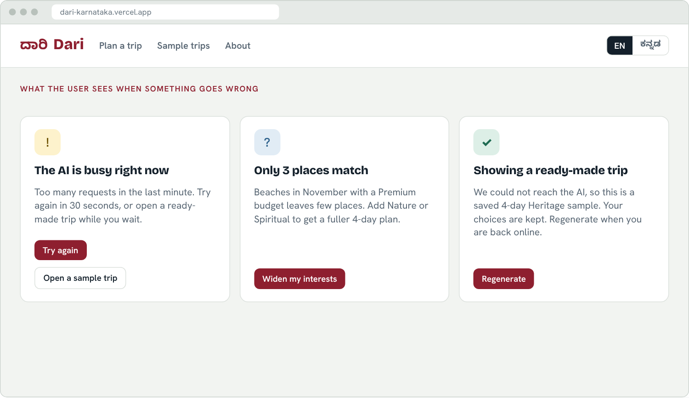

# Dari (ದಾರಿ): AI Travel Planner for Karnataka. Build Specification

Problem statement 06 of the Kannada Digital Innovation Hackathon 2026 (HackerRank Campus Crew, NIE Mysuru). Individual participation. This document is written so that an AI coding agent (Antigravity) can build the whole project from it. The mockup images are in `mockups/`.

## 0. Instructions to the coding agent

1. Read this whole document before writing code.
2. Build the stages in section 11 in order. Finish and run each stage before starting the next.
3. Never let the AI model invent places, coordinates, prices or Kannada text. All of those come from the curated JSON files in `data/`. The model only chooses and orders places by id and writes short English notes.
4. The app must work even when the AI provider is down. A deterministic planner and saved sample itineraries are required fallbacks.
5. Never commit secrets. Keep keys in environment variables and ship a `.env.example`.
6. Commit after every stage with a meaningful message (judges read the history).
7. Where this document gives a model name, a price or an opening hour, treat it as a value to verify, not a fact.

## 1. Deadline and deliverables

| Item | Value |
|---|---|
| Event | Kannada Digital Innovation Hackathon 2026, theme "Code. Create. Celebrate Kannada." |
| Participation | Individual, one problem statement (06) |
| Submission window on Unstop | 24 Oct 2026 12:00 AM to 25 Oct 2026 10:00 PM IST |
| Personal target | Submit by Sun 25 Oct, 6:00 PM IST |
| Deliverable 1 | Public GitHub repo with README, meaningful commits, `.env.example`, no secrets |
| Deliverable 2 | PPT or PPTX: problem, existing system, how ours differs, approach, tech stack with architecture diagram, conclusion |
| Deliverable 3 | Live deployed URL that stays online until results; no login required |
| Deliverable 4 | 3 to 5 minute screen recording with voice-over (no face needed) |

Incomplete submissions may not be evaluated, so all four are part of the build, not extras.

## 2. Product concept

Dari means "way" or "path" in Kannada. The user enters interests, number of days, budget, pace and travel month. Dari returns a day-by-day Karnataka itinerary with timings, travel time between stops, a rupee estimate, a route on a map, and Kannada names and phrases for every stop.

What makes it different from a generic AI planner:

1. **Real places only.** Every stop is picked from a curated dataset of Karnataka places. The model refers to places by id, and the server rejects any id that does not exist.
2. **Kannada is first class.** One toggle switches the whole interface and the plan to ಕನ್ನಡ. Kannada names, descriptions and phrases come from the checked dataset, never from the AI, so they are not garbled.
3. **Phrases at every stop.** Each place carries 2 to 3 useful phrases (tickets, food, directions) with transliteration, English meaning and audio.
4. **Works offline from the AI.** A deterministic planner builds a valid itinerary by itself, so a quota error never breaks the demo.
5. **Beyond the usual route.** Dataset includes Badami, Pattadakal, Gokarna, Belur, Halebidu, Chikkamagaluru, Dharwad and Bidar, not just Mysuru, Hampi and Coorg.

## 3. Best tech stack

| Layer | Choice | Why |
|---|---|---|
| Framework | Next.js 14+ (App Router) with TypeScript | UI and API route in one repo and one deploy; strong agent support |
| Styling | Tailwind CSS | Fast, consistent, easy to theme |
| UI language | Plain TS dictionary files `en.json` and `kn.json`, small custom hook | No heavy i18n library needed for two languages |
| Fonts | Bricolage Grotesque (headings), Hanken Grotesk (body), Noto Sans Kannada (Kannada) via `next/font/google` | Correct Kannada rendering on every device |
| AI (primary) | Groq API, model from `GROQ_MODEL` (start with a Llama 3.3 70B class model; verify the current id in the Groq console) | Fast, free tier, JSON mode |
| AI (fallback) | Gemini API, model from `GEMINI_MODEL` (a Flash model; verify the current id in Google AI Studio) | Second provider if Groq rate-limits |
| Validation | Zod | Validates the request and the model output |
| Map | Leaflet + react-leaflet + OpenStreetMap tiles | Free, no key, no billing |
| Audio | Browser Web Speech API (`speechSynthesis`, `lang = "kn-IN"`) | Free; hide the button when no Kannada voice exists |
| Share link | `lz-string` compresses the plan into the URL (`/trip?d=...`) | No database needed |
| Data | JSON files in `data/` | No database to run or debug |
| Hosting | Vercel (free) | Live URL from GitHub in minutes |
| Tests | Vitest for planner, validators and cost maths | Quick proof of correctness |

Rejected: Streamlit (generic look, weak Kannada and map UX), Flutter or native mobile (slow to set up and harder for judges to open), a database or auth (adds risk, no benefit for this scope), letting the LLM generate Kannada or coordinates (hallucination risk).

## 4. Architecture and data flow


Request flow for `POST /api/plan`:

1. **Validate** the JSON body with Zod. Apply a best-effort per-IP rate limit (in-memory map; acceptable on a free tier).
2. **Retrieve candidates** from `data/places.json`: filter by interests, travel month (best months), budget tier, and distance from the start city; rank by score; keep about 2.5 times the number of stops needed.
3. **Call the AI**: send only the candidate places (id, name, region, categories, duration, coordinates) plus the trip brief. Ask for JSON that references place ids. Try Groq first, then Gemini.
4. **Validate the output** with Zod. Reject unknown place ids, duplicate places, wrong day count, or days that exceed the daily time budget. Retry once with the error message appended. If it still fails, use the deterministic planner.
5. **Enrich and return**: attach names in both languages, descriptions, phrases, coordinates, entry costs and computed travel times and costs, then return one JSON plan.

The deterministic planner (`lib/planner.ts`) must be able to produce a valid itinerary with no AI at all. It clusters nearby places greedily, fills each day to the pace limit and orders stops by nearest neighbour. The same function is the fallback and the validator of last resort.

## 5. Repository structure

```
dari/
  README.md
  .env.example            # GROQ_API_KEY, GROQ_MODEL, GEMINI_API_KEY, GEMINI_MODEL
  package.json
  data/
    places.json           # 30 to 40 curated places (schema below)
    phrases.json          # reusable Kannada phrases
    samples/              # 4 saved itineraries for fallback and the demo
  src/
    app/
      page.tsx            # landing
      plan/page.tsx       # form + generating state
      trip/page.tsx       # result, reads ?d= or the in-memory plan
      api/plan/route.ts   # the pipeline in section 4
    components/
      PlannerForm.tsx, ProgressSteps.tsx, DayTabs.tsx, StopCard.tsx,
      PhraseCard.tsx, TripMap.tsx (dynamic import, ssr:false), CostSummary.tsx,
      LangToggle.tsx, ErrorState.tsx
    lib/
      schema.ts           # Zod schemas and TS types
      candidates.ts       # filtering and scoring
      planner.ts          # deterministic planner + validator
      ai.ts               # Groq and Gemini clients, prompt builder, retry
      enrich.ts           # names, phrases, costs, travel times
      geo.ts              # haversine, road factor, travel time
      cost.ts             # budget tiers, estimates
      i18n/en.json, i18n/kn.json, useLang.ts
      speech.ts           # speak(text) with voice detection
  tests/                  # Vitest
```

## 6. Data model

### 6.1 Place (`data/places.json`)

```ts
type Place = {
  id: string;                       // "mysore-palace"
  name_en: string; name_kn: string; // Kannada checked by a native speaker
  region: "Mysuru" | "Hassan" | "Hampi-Ballari" | "Badami-Bagalkot" | "Coast"
        | "Coorg" | "Chikkamagaluru" | "Bengaluru" | "Dharwad-Hubballi" | "Kalyana-Karnataka" | "North Kannada";
  city: string;
  lat: number; lng: number;
  categories: ("heritage"|"nature"|"food"|"spiritual"|"adventure"|"beach"|"wildlife"|"coffee"|"culture")[];
  duration_min: number;             // typical visit
  entry_inr: number;                // 0 if free
  best_months: number[];            // 1..12
  budget_fit: ("budget"|"mid"|"premium")[];
  is_meal?: "breakfast"|"lunch"|"dinner"|"snack";   // food stops
  desc_en: string; desc_kn: string; // 1 to 2 sentences
  tip_en: string; tip_kn?: string;
  phrase_ids: string[];             // 2 to 3 from phrases.json
  verified: boolean;                // true only after checking a source
  source_url?: string;
};
```

### 6.2 Phrase (`data/phrases.json`)

```ts
type Phrase = { id: string; kn: string; translit: string; en: string;
  context: "greeting"|"ticket"|"food"|"directions"|"transport"|"shopping"|"temple"|"thanks"; };
```

Starter phrases (have a native speaker confirm before release): ticket elli siguttade? (ಟಿಕೆಟ್ ಎಲ್ಲಿ ಸಿಗುತ್ತದೆ?), idakke eshtu? (ಇದಕ್ಕೆ ಎಷ್ಟು?), neeru kodi (ನೀರು ಕೊಡಿ), dhanyavadagalu (ಧನ್ಯವಾದಗಳು), dayavittu (ದಯವಿಟ್ಟು), bus nildana ellide? (ಬಸ್ ನಿಲ್ದಾಣ ಎಲ್ಲಿದೆ?), tumba chennagide (ತುಂಬಾ ಚೆನ್ನಾಗಿದೆ), ondu masale dose kodi (ಒಂದು ಮಸಾಲೆ ದೋಸೆ ಕೊಡಿ).

### 6.3 Request and response

```ts
type PlanRequest = {
  interests: string[];              // 1..4 of the category values
  days: number;                     // 1..7
  start_city: "Bengaluru" | "Mysuru" | "Mangaluru" | "Hubballi";
  budget: "budget" | "mid" | "premium";
  pace: "relaxed" | "balanced" | "packed";   // 2-3 / 3-4 / 5+ stops per day
  travellers: "solo" | "couple" | "family" | "friends";
  month: number;                    // 1..12
  lang: "en" | "kn";
};

type Plan = {
  title: string; summary: string;
  days: { day: number; theme: string; stops: Stop[]; travel_total_min: number }[];
  cost: { stay: number; food: number; transport: number; entry: number; total: number; people: number };
  tips: string[];
  source: "ai-groq" | "ai-gemini" | "planner" | "sample";   // shown in a small footer note
};
type Stop = { place_id: string; start: string; duration_min: number; note_en: string;
  travel_from_prev?: { km: number; min: number; mode: "auto"|"cab"|"bus" };
  place: Place; phrases: Phrase[] };
```

### 6.4 Starter place list (about 34; fill every field, mark `verified:false` until checked)

Mysuru region: Mysore Palace, Chamundi Hill, Devaraja Market, Mysore Zoo, Brindavan Gardens, Mylari Dosa (meal), Srirangapatna (Ranganathaswamy Temple, Tipu's Summer Palace), Somanathapura (Chennakeshava Temple).
Hassan region: Belur (Chennakeshava Temple), Halebidu (Hoysaleswara Temple), Shravanabelagola (Gommateshwara).
Hampi: Virupaksha Temple, Vittala Temple and Stone Chariot, Hemakuta Hill sunset, Lotus Mahal and Elephant Stables.
Badami area: Badami Cave Temples, Pattadakal, Aihole.
North Karnataka: Gol Gumbaz (Vijayapura), Bidar Fort, Kalaburagi Fort.
Coast: Gokarna (Mahabaleshwar Temple, Om Beach), Udupi Sri Krishna Temple, Murudeshwar, Malpe Beach.
Coorg and hills: Abbey Falls, Raja's Seat (Madikeri), Dubare Elephant Camp, Mullayanagiri (Chikkamagaluru).
Nature: Jog Falls, Kabini or Bandipur safari.
Bengaluru: Lalbagh, Bangalore Palace, VV Puram Food Street (meal), Vidyarthi Bhavan (meal).

For each place, check entry fee, closed days and timings on an official or reputable source and fill `source_url`. Do not ship a number you have not checked; set `verified:false` and show "about" in the UI for estimates.

## 7. AI prompt design

**System prompt (store in `lib/ai.ts`):**

```
You are a Karnataka trip planner. You receive a trip brief and a list of CANDIDATE PLACES.
Rules:
1. Use ONLY place ids from the candidate list. Never invent places, ids, prices or distances.
2. Produce exactly {days} days. Each day holds {min_stops} to {max_stops} stops.
3. Put geographically close places on the same day. Use the lat/lng provided. Avoid days with more than 4 hours of driving in total.
4. Respect each stop's duration_min. Start between 08:30 and 10:00 and finish before 19:30. Include a meal stop around 12:30 to 14:00 when a meal place is available.
5. Match the traveller's interests and pace. Prefer places whose best_months include the travel month.
6. Write one short note per stop in plain English (max 18 words): why it fits and one practical tip.
7. Output valid JSON only, matching the schema. No prose outside the JSON.
```

**Model output schema** (small on purpose; the server enriches everything else):

```json
{ "title": "string", "summary": "string (max 30 words)",
  "days": [ { "day": 1, "theme": "string (max 6 words)",
    "stops": [ { "place_id": "string", "start": "HH:MM", "note_en": "string" } ] } ],
  "tips": ["string"] }
```

Use JSON mode where the provider supports it. Temperature 0.4. On Zod failure retry once with the validation error appended, then fall back to `planner.ts`.

## 8. API contract

`POST /api/plan` returns `200 { plan }`, `400 { error: "invalid_input", details }`, `429 { error: "busy", retry_after_s }`, or `200` with `plan.source = "planner"` or `"sample"` when the AI is unavailable. It must never return a raw provider error. Set `maxDuration` on the route to 30 seconds.

## 9. Design system (from the mockups)

| Token | Value | Use |
|---|---|---|
| `--red` | `#8E1F2F` | Primary buttons, selected chips, Day 1 |
| `--gold` | `#F2B705` / soft `#FDF2CC` | Selected segments, phrase cards (flag colours of Karnataka) |
| `--green` | `#1E6B52` / soft `#DDEFE7` | Success, Day 3 |
| `--blue` | `#2B5F8A` / soft `#E1ECF5` | Info, Day 4 |
| `--ink` | `#14202B` | Text, dark summary bar |
| `--mute` | `#586673` | Secondary text |
| `--bg` | `#F2F4F1` | Page background (cool stone) |
| `--line` | `#DCE1DD` | Borders |

Day colours on the map: red, gold (`#D99A00`), green, blue. Radius 8 to 12 px. Headings Bricolage Grotesque 800, body Hanken Grotesk, Kannada Noto Sans Kannada. Minimum body size 14 px, tap targets at least 40 px on mobile. Support a dark theme through CSS variables if time allows; it is optional.

## 10. Cost and travel maths (deterministic, in code)

* Travel distance between stops: haversine distance multiplied by 1.3 (road factor). Time: distance divided by 40 km/h, plus 10 minutes. Round to 5 minutes. Mark as an estimate in the UI.
* Stay and food per person per day by tier (constants in `cost.ts`, shown as ranges, verify before the demo): budget under Rs 2,500, mid Rs 2,500 to 5,000, premium above Rs 5,000.
* Transport: kilometres times a per-km rate for auto or cab, with a shared-cab assumption for 2 or more people.
* Entry: sum of `entry_inr` for the stops, times the number of people (solo 1, couple 2, family 4, friends 4).
* Total is shown as an estimate with the breakdown in the bar at the bottom of the day list.

## 11. Stages, interface and acceptance criteria

### Stage 1: Foundation and landing page (Fri evening)


Tasks: scaffold Next.js with TypeScript and Tailwind; add fonts and tokens; build the nav with the EN / ಕನ್ನಡ toggle; build the hero, three destination tiles and the three feature cards; create `i18n` dictionaries and `useLang`; push to GitHub; deploy an empty shell to Vercel.
Acceptance: the page renders in English and Kannada with no tofu boxes; the Vercel URL is live; Lighthouse accessibility score above 90.

### Stage 2: Data and planner form (Fri night)


Tasks: write `places.json` (at least 30 places) and `phrases.json`; write Zod schemas; build `PlannerForm` with interest chips (1 to 4), days stepper (1 to 7), start city, budget and pace segmented controls, traveller chips and month select; build the live "Your trip brief" side panel with the count of matching places from `candidates.ts`.
Acceptance: changing any field updates the brief and the match count instantly; the submit button is disabled until at least one interest is chosen; validation messages are readable in both languages.

### Stage 3: Planner pipeline and generating state (Sat morning)


Tasks: implement `candidates.ts`, `planner.ts`, `geo.ts`, `cost.ts`, `enrich.ts`; implement `ai.ts` (Groq, Gemini fallback, retry); implement `api/plan`; build `ProgressSteps` that advance on a timer while the request runs; unit-test the planner and validators.
Acceptance: with AI keys removed, the app still returns a valid itinerary from `planner.ts`; with the keys set, the response uses only known place ids (test by injecting a fake id); response arrives in under 15 seconds.

### Stage 4: Itinerary view and map (Sat afternoon)


Tasks: build `DayTabs`, `StopCard` (time, duration, entry cost, category pill, note), travel chips between stops, `CostSummary`, and `TripMap` (Leaflet via dynamic import with `ssr:false`; numbered `divIcon` pins coloured by day; dashed polyline in stop order; `fitBounds` on the selected day; click a pin to scroll to its card); add "Share link" (lz-string in the URL) and "Regenerate".
Acceptance: switching days re-centres the map; the share link opens the same trip in a fresh browser; costs add up to the total shown.

### Stage 5: Kannada mode and phrases (Sat evening)


Tasks: toggle swaps UI strings, place names, descriptions, tips and map labels to Kannada; `PhraseCard` under each stop with Kannada text, transliteration, English meaning and a speaker button using `speechSynthesis` with `lang="kn-IN"`; detect whether a Kannada voice exists and hide the speaker (keeping transliteration) if not.
Acceptance: no AI-generated Kannada anywhere; every phrase shown comes from `phrases.json`; the language choice persists across pages (`localStorage` inside try/catch).

### Stage 6: Error, empty and fallback states (Sun morning)



Tasks: build `ErrorState` for busy (429), too few matches (offer to widen interests), and fallback to a saved sample (source note shown); add four saved samples in `data/samples/` (Heritage, Nature, Food and Beaches, Mixed); never show a raw error.
Acceptance: simulate each failure (invalid key, 429, malformed JSON, zero candidates) and confirm the matching screen appears.

### Stage 7: Mobile, polish and deployment (Sun morning)


Tasks: responsive layout; on phones the result uses bottom tabs Plan, Map, Phrases and a bottom sheet for the selected stop; check at 360 px width; set environment variables in Vercel; test the live URL on a real phone; add a favicon and Open Graph image.
Acceptance: no horizontal scroll at 360 px; the form, result, map and Kannada toggle all work on the live URL from a phone.

## 12. Testing checklist

* Unit tests: `candidates` scoring, `planner` produces N days with valid stop counts, `validate` rejects fake ids and overlong days, cost totals, haversine.
* Manual: 6 different briefs including 1 day, 7 days, beach-only in monsoon months, and a premium trip; Kannada mode on each; phone test.
* Security: no key in the repo history (`git log -p | grep -i key`), `.env.example` present, API route never echoes provider errors.

## 13. Schedule (IST, about 55 hours; submit by Sun 6 PM)

| When | Work |
|---|---|
| Fri 23 Oct, 3 to 11 PM | Stage 1, Stage 2 (data: at least 20 places tonight), first commit and deploy |
| Sat 24 Oct, 8 AM to 1 PM | Stage 3 pipeline end to end |
| Sat 24 Oct, 2 to 7 PM | Stage 4 itinerary and map |
| Sat 24 Oct, 8 to 11 PM | Stage 5 Kannada mode, finish dataset to 30+ places |
| Sun 25 Oct, 8 to 11 AM | Stage 6 and Stage 7 |
| Sun 25 Oct, 11 AM to 1 PM | README and PPT |
| Sun 25 Oct, 1 to 3 PM | Record and edit the video |
| Sun 25 Oct, 3 to 6 PM | Test every link, upload all four items on Unstop |

## 14. Submission pack

### 14.1 README outline

Project name and one-line pitch; problem statement chosen (06); screenshots; features; how it works (the architecture image); tech stack; setup and run (`npm i`, copy `.env.example` to `.env.local`, `npm run dev`); environment variables; data sources and verification note; limitations; live URL; licence.

### 14.2 PPT outline (the required sections, 8 slides)

1. Title: Dari, AI Travel Planner for Karnataka (name, college, problem 06).
2. **Problem statement:** visitors and residents struggle to plan Karnataka trips that match interests, time and budget; who is affected; why it matters for tourism and regional development.
3. **Existing system:** generic planners and blogs; limits: hallucinated places, no Kannada, no cost realism, ignore less-visited regions.
4. **How our solution is different:** real-places dataset, Kannada first class, phrases at every stop, works without the AI, route and cost estimate.
5. **Approach:** retrieval, constrained AI planning, validation, enrichment; key design decisions (ids not free text, deterministic fallback, Kannada from checked data).
6. **Tech stack and architecture diagram:** use `00-architecture.png`.
7. **Demo screens:** four screenshots from the mockups or the live app.
8. **Conclusion:** impact, limitations, future scope (more places, live opening hours, booking links, offline PWA, voice input).

### 14.3 Video script (3 to 5 minutes, voice-over)

| Time | Content |
|---|---|
| 0:00 to 0:45 | Problem statement 06 and what the hackathon asked for |
| 0:45 to 1:30 | Existing planners and their gaps |
| 1:30 to 3:30 | Live demo: fill the form, watch the progress, open the result, switch days, show the map, toggle Kannada, play a phrase, copy the share link, show a fallback |
| 3:30 to 4:30 | Tech stack and architecture; why ids and validation stop hallucinations |
| 4:30 to 5:00 | Conclusion and future scope |

### 14.4 Final checklist

- [ ] Registered on Unstop (registration closed 23 Oct 12:00 AM IST; confirm with the organisers if not)
- [ ] GitHub repo public, README done, `.env.example` present, no secrets
- [ ] PPT covers all six required sections
- [ ] Live URL opens without errors on a phone
- [ ] Video is 3 to 5 minutes with clear audio
- [ ] All four links submitted through the official Unstop form before 25 Oct 10 PM IST

## 15. Master prompt to paste into Antigravity

```
Build the project described in BUILD_SPEC.md (attached) in the current workspace.
Follow section 11 stage by stage. After each stage: run the dev server and tests, fix errors,
and make one git commit. Stack: Next.js (App Router, TypeScript), Tailwind, Zod, Leaflet,
Groq with Gemini fallback. Hard rules: the AI may only reference place ids from data/places.json;
all Kannada text comes from data files; a deterministic planner must work with no API keys;
no secrets in the repo. Match the layouts in the mockups/ images and the design tokens in
section 9. Start with Stage 1 and tell me when each stage is ready to review.
```
